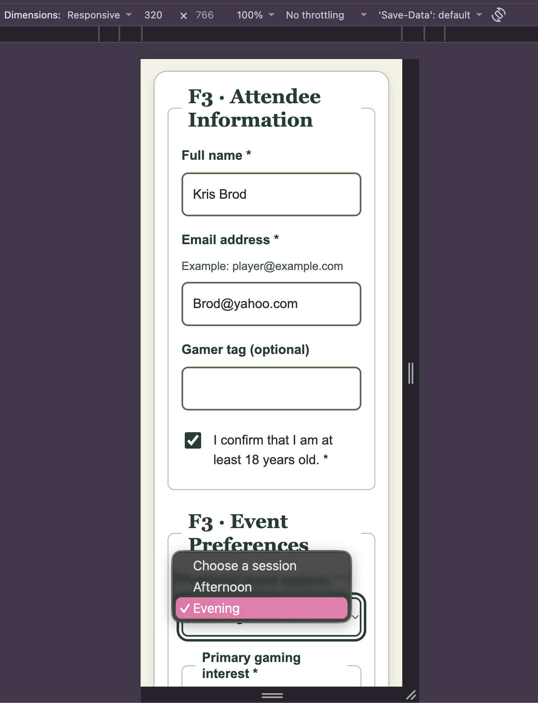
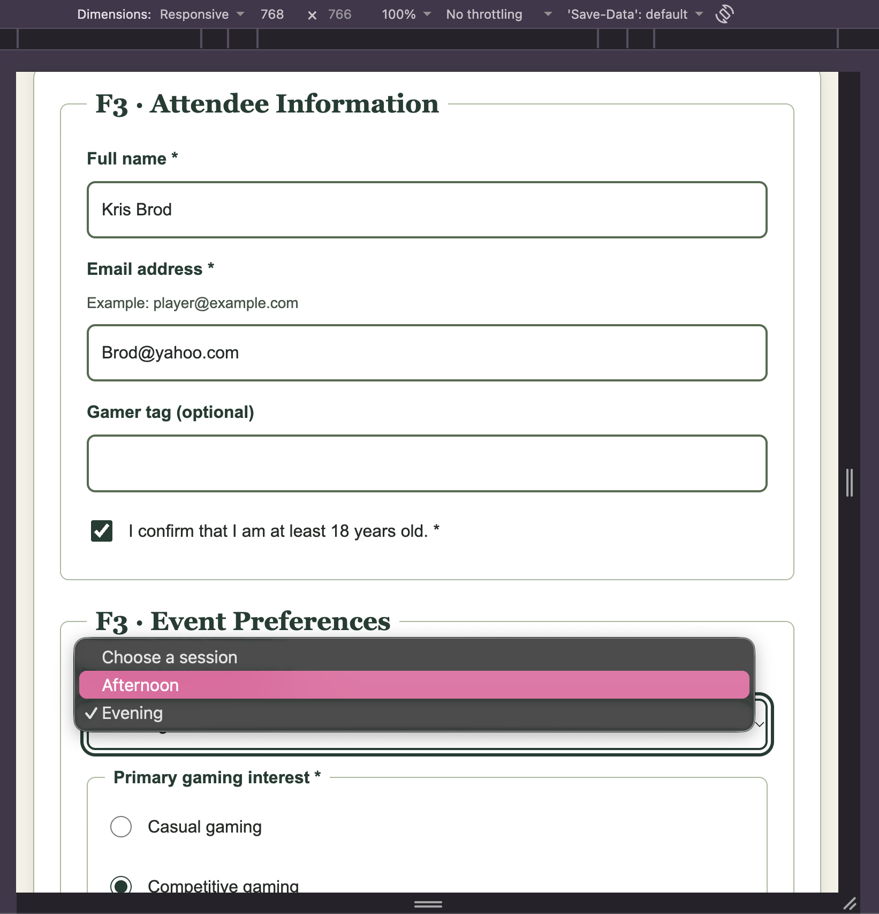
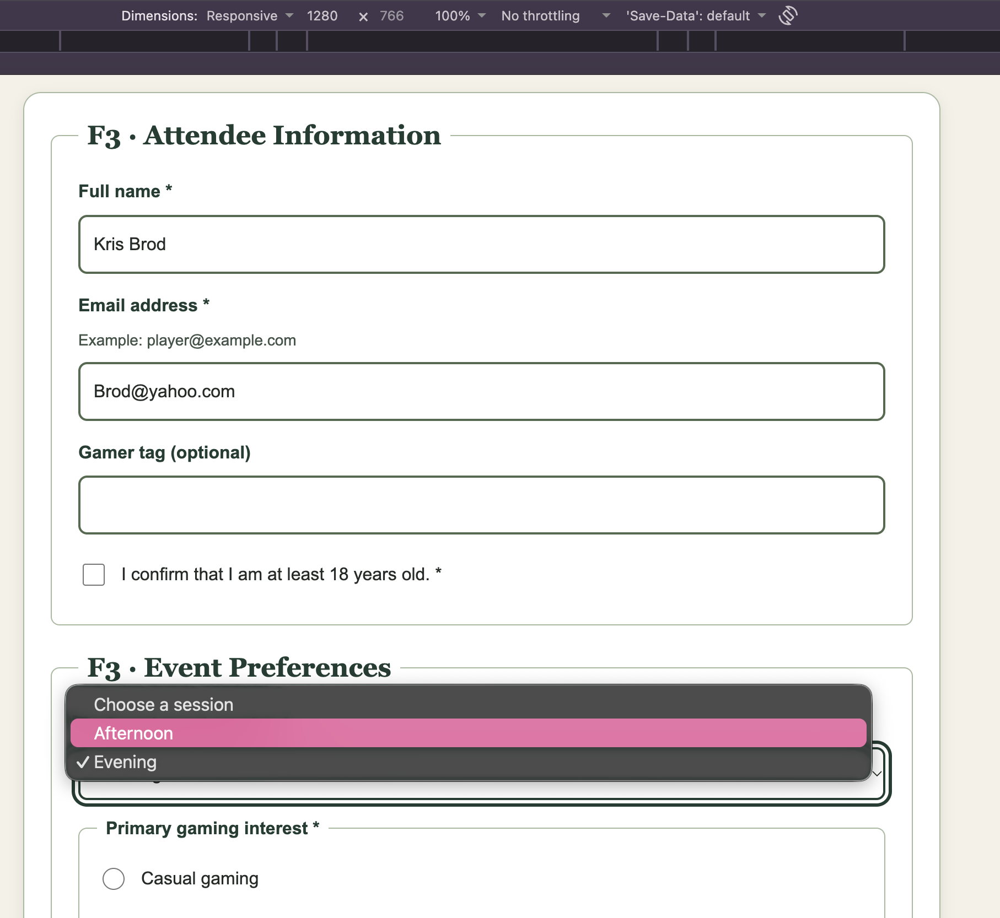
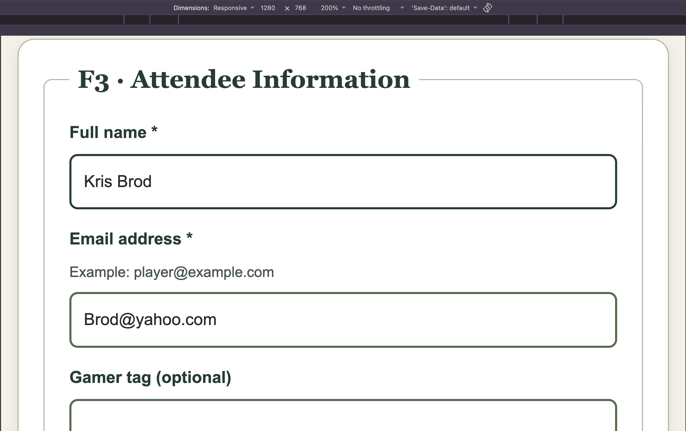
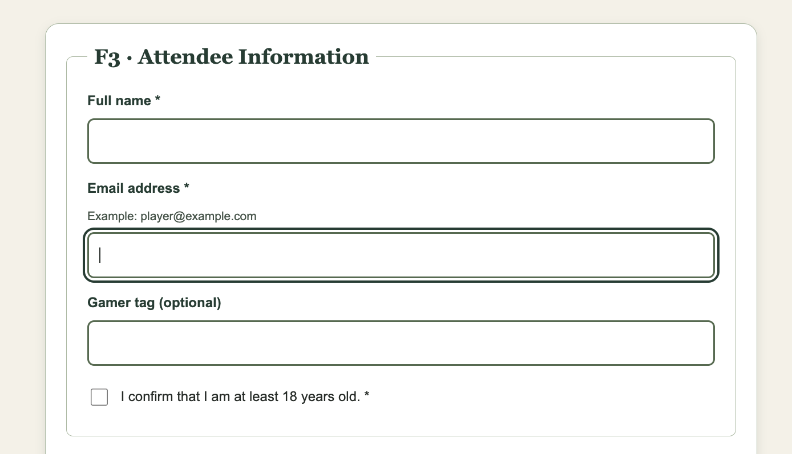
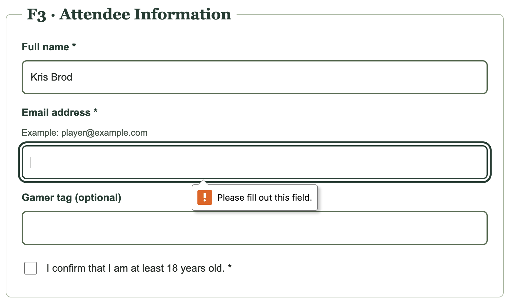
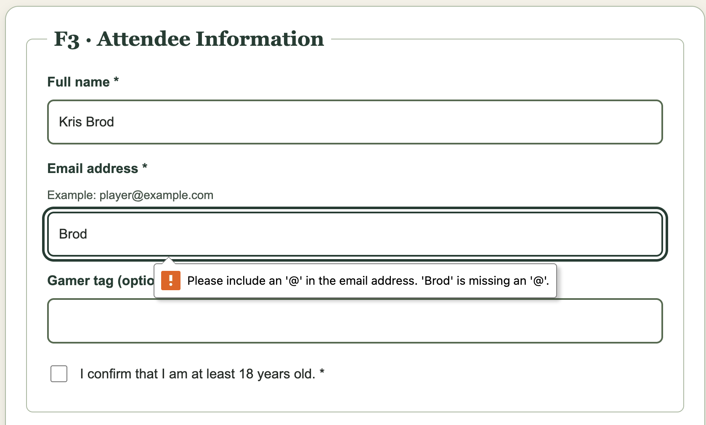
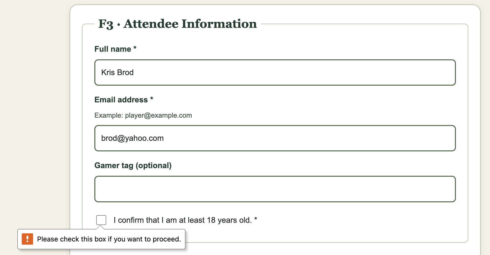
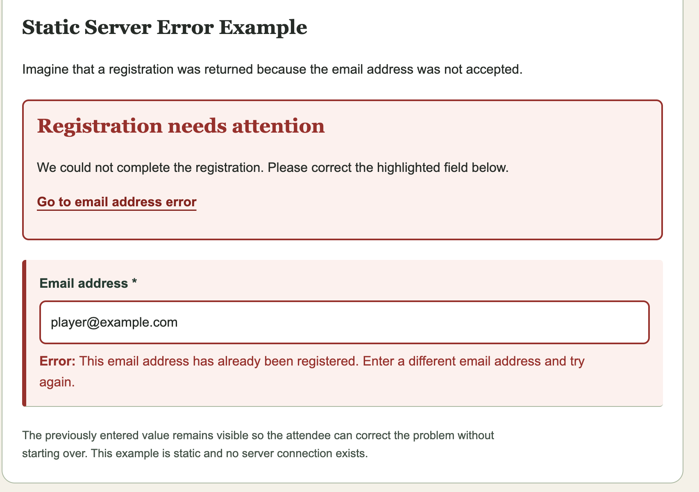

# PixelFest 2027: Test Record

## Testing Environment
- Browser: Chrome
- Operating system: MAC OS
- Date tested: 11/06/2026
- Tester: Kristin Wojcik

## HTML and CSS Validation
- HTML validator: https://validator.w3.org/nu/
- HTML result:Document checking completed. No errors or warnings to show.
- CSS validator: https://jigsaw.w3.org/css-validator/validator
- CSS result:Congratulations! No Error Found. This document validates as CSS level 3 + SVG 
- Corrections made: None needed.

## Keyboard Accessibility
- Can navigate using Tab: Pass, I was able to navigate through the form's interactive elements using the TAB key without using a mouse.
- Focus indicator visible: Pass, A visible outline appeared around focused form controls, making it clear which element was selected.
- Radio groups operable with arrow keys: Pass, I was able to navigate between radio button options using the arrow keys and select my preferred option.
- Checkboxes operable with Space: Pass, I was able to check and uncheck boxes using the SPACE bar.
- Can reach submit button: Pass, I was able to reach the "Register for PixelFest" button using TAB and activate it using ENTER.
- Submission attempt result: Native HTML validation prevented submission when required fields were empty or an email address was incorrectly formatted. With valid information, the browser attempted to navigate to the configured destination. No real registration was created. Using the method="get" shows information in the url once submitted.

## Accessible Names and Groups
- Text field label: Full Name *: The text input has a visible label connected using for="full-name" and id="full-name".
- Radio group legend: Primary gaming interest *: The radio buttons are grouped within a <fieldset> and identified by a <legend>.
- Checkbox label: I can confirm that I am at least 18 years old. *: The checkbox is wrapped inside a <label>, providing an accessible name.
- Select label: Preferred event session *: The dropdown uses a visible <label> connected to id="session".
- Textarea label: Accessibility accommodations (optional): The textarea has a visible label connected using for="accessibility" and id="accessibility".
- Results and corrections: All controls passed accessibility inspection; no corrections were necessary.

## Validation Tests
| Test | Fictional input | Expected result | Actual result | Pass/Fail |
|---|---|---|---|---|
| Empty submission | All required fields blank | Native validation prevents valid submission | Browser displayed a required-field message and prevented submission. | PASS |
| Malformed email | player.example | Email validation error | Browser displayed an email-format error and prevented submission. | PASS |
| Minimum boundary | Shortest permitted value | Accepted if valid | The field accepted the single character because no minimum length is specified. | PASS |
| Maximum boundary | 80-character full name | Accepted | The field accepted all 80 characters. | PASS |
| Over maximum | More than 80 characters | Input limited to 80 characters | Browser prevented additional characters from being typed beyond 80. | PASS |
| Valid submission | All required fields completed | Native validation passes; prototype-only navigation | Browser accepted the entries and attempted to navigate to the configured destination. | PASS |

## Responsive Tests
| Viewport | Layout | Horizontal overflow? | Pass/Fail |
|---|---|---|---|
| 320px | Mobile layout displayed in a single column. Form fields, labels, and buttons adjusted to fit the narrow screen. | NO | PASS |
| 768px | Tablet layout displayed correctly with appropriate spacing and readable form controls | NO | PASS |
| 1280px | Desktop layout displayed with a centered form, consistent spacing, and readable content. | NO | PASS |
| 200% zoom | Text and form controls enlarged while maintaining a readable layout. Content remained accessible without horizontal scrolling. | NO | PASS |

## F5: Form State Matrix

| State | Visual or Functional Behavior | Accessibility and Recovery |
|---|---|---|
| Default | Empty input with a visible label and neutral border. | Users can identify the field before entering information. |
| Focus | A visible green outline appears when navigating using the keyboard. | Makes the active field identifiable without a mouse. |
| Required | Required fields are marked with an asterisk (*) and use the `required` attribute. | Native validation identifies missing required information. |
| Valid | Correctly formatted information is accepted. The example displays a green border. | Users can proceed without an error. |
| Invalid | An invalid field displays a red border and explanatory error text. | Error text identifies the problem and explains how to fix it. |
| Disabled | Control appears gray and cannot be edited or activated. | Disabled controls are excluded from keyboard navigation. |
| Static server-returned error | Error summary identifies the affected email field and displays a fictional registration error. | Previous input remains visible, and instructions explain how to correct the error. |

**Implementation note:** The state specimens demonstrate visual and semantic behavior. The prototype uses native HTML validation and does not connect to a live server.

## Interaction Tests
- Touch targets comfortably sized: PASS. Form inputs, buttons, radio options, and checkboxes were easy to activate at mobile screen sizes. Associated labels provided additional clickable areas.
- Labels activate associated controls: PASS. Clicking text labels correctly focused text fields or selected the associated radio buttons and checkboxes.
- Errors include text and visual cues: PASS. Error examples used red borders, highlighted backgrounds, and written error messages rather than relying on color alone.
- Error recovery instructions clear: PASS. Error messages identified the affected field, explained the problem, and provided instructions for correcting the entry.
- Previous values preserved in error specimen: PASS. The static server-error example retained the email address, allowing users to edit the existing value rather than reentering all their information.

## Screenshots

### Mobile: 320px

### Tablet: 768px

### Desktop: 1280px

### 200% Zoom

### Keyboard Focus

#### Invalid State 1: Required Field

#### Invalid State 2: Email Format

#### Invalid State 3: Required Checkbox

### Static Server Error

## Outstanding Issues
- None

## AI Disclosure
- AI was used to support planning, coding, troubleshooting, and understanding accessibility concepts. I reviewed the recommendations, tested the form, and documented the results. I take responsibility for the final design, implementation, and submitted work.